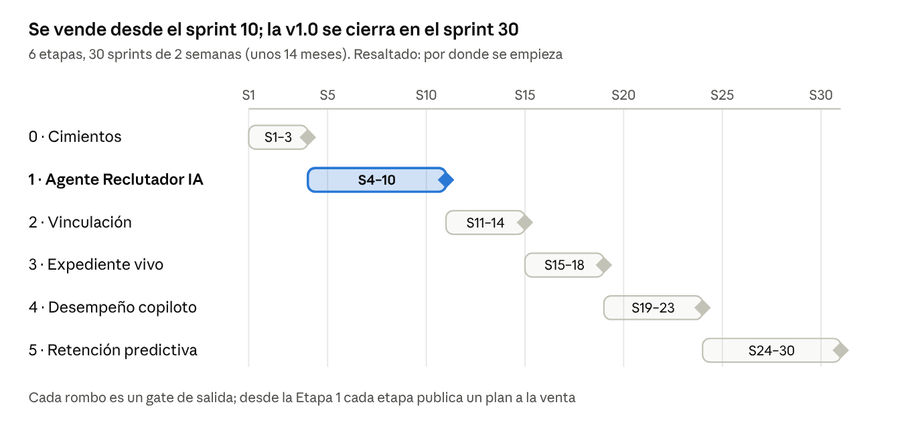

# Selvana – Plan de trabajo detallado

Oct 21, 2026 · @Ricardo Nivia

## Resumen

Selvana se construye en **6 etapas y 30 sprints de 2 semanas (unos 14 meses)**. Arranca con el **Agente Reclutador IA**: en la Etapa 1 la IA ya publica la vacante, lee las hojas de vida, valida requisitos por WhatsApp, aplica pruebas y puntúa, y la persona de RRHH solo revisa y aprueba.

**Por qué empezar por el reclutamiento:**

- Es el proceso más manual y repetitivo: revisar hojas de vida y llamar candidatos consume la mayor parte del tiempo de un analista de selección.
- Es donde la IA muestra valor visible el primer día, y donde la competencia (Buk, SAP) está lanzando agentes en 2026.
- Sirve a todos los mercados: empresas de servicios temporales, retail, BPO, industria y corporativo.
- Crea la entidad **Persona** que reutilizan todas las etapas siguientes.

**Regla de oro del producto:** la IA trabaja, el humano decide. Ninguna pantalla debe ser un formulario para llenar a mano si la IA puede prellenarlo; el usuario confirma, corrige o rechaza.

**Primero la marca y el design system:** el proyecto arranca con la Etapa D. Antes de diseñar cualquier pantalla o escribir frontend se crean la marca de Selvana y su design system en Claude Design, con el theme listo para el código.

Cada etapa termina con un **gate**: no se arranca la siguiente sin cumplir sus criterios de salida.

## Avance y orden de trabajo (actualizado el 28/10/2026)

El orden real se ajustó para tener un flujo completo de punta a punta antes de cerrar la Etapa 1: se adelantaron Vinculación (Etapa 2) y el portal de la persona. Las integraciones (WhatsApp, correo, firma certificada, conectores de ERP) van al final; mientras tanto cada paso tiene su versión manual asistida o por enlace.

| Bloque | Estado |
| --- | --- |
| Etapa D · Marca Dosel y design system | Hecho |
| Etapa 0 · Cimientos (gateway de IA, mensajería, nómina por archivo, estructura, usuarios y roles, bitácora, Ley 1581) | Hecho; falta pgvector |
| Etapa 1 · Sprints 4, 6, 7 y 8 (web) | Hechos |
| Etapa 1 · Sprint 5 · Portal de empleo y postulación | Hecho; marca propia y bolsas externas, después |
| Etapa 1 · Sprint 9 · Suite psicotécnica fase 1 e informe de finalistas | Hecho; fases 2 y 3 esperan al psicólogo |
| Etapa 2 · V1 Contratación y oferta, con maestro de tipos de contrato y plantillas | Hecho |
| Etapa 2 · V2 Documentos de ingreso · V3 Alta y afiliaciones | Hechos |
| Portal de la persona · P1 a P3b (cuenta, procesos, pendientes, ofertas para ti) y rediseño | Hecho |
| Etapa 2 · V4 Onboarding · plan de inducción con seguimiento | Hecho; asistente de bienvenida con las integraciones y encuestas de 30, 60 y 90 días con Clima |
| Etapa 3 · Empleados E1 · Expediente digital y carga de la planta | Hecho |
| Etapa 3 · Empleados E2 · Actualización inteligente | Hecho; campaña anual con el asistente, con las integraciones |
| **Etapa 3 · Empleados E3 y E4** | **Sigue** |
| Portal · P4 Mis documentos · P5 Portal del empleado | Después de E1 |
| Etapa 4 · Desempeño · Etapa 5 · Clima | Después |
| Etapa 1 · Sprint 10 · Estabilización y lanzamiento | Antes de vender el primer plan |
| Integraciones (WhatsApp, correo, firma, ERP) | Al final |

## IA primero: qué hace la IA y qué aprueba el usuario

La diferencia con una aplicación normal de talento humano es que cada proceso tiene un **agente** que ejecuta el trabajo y deja al usuario una bandeja de aprobaciones.

**Regla general (28/10/2026): todo lo que hace o configura la IA también lo puede hacer o configurar una persona a mano.** Cada resultado de la IA se edita, se crea desde cero sin IA o parte de una plantilla o regla de base; lo que la IA usa para trabajar (descripciones, plantillas, filtros, catálogos, pesos) lo configura el usuario; y ningún flujo se detiene si la IA falla, se apaga o la empresa no quiere usarla. Cada bloque nuevo se entrega con su camino manual.

| Proceso | Aplicación tradicional (el usuario hace) | Selvana (la IA hace) | El usuario solo… |
| --- | --- | --- | --- |
| Crear vacante | Redacta perfil y aviso | Genera perfil, aviso, preguntas filtro y rango salarial sugerido a partir de una frase o un cargo existente | Aprueba o ajusta |
| Recibir hojas de vida | Las abre una por una | Lee PDF, Word, foto o LinkedIn, extrae datos y detecta inconsistencias | Nada |
| Preseleccionar | Lee y decide | Puntúa afinidad con explicación, ordena y propone la terna | Aprueba la terna |
| Primer contacto | Llama a cada candidato | Conversa por WhatsApp o web: confirma interés, salario, disponibilidad y requisitos | Lee el resumen |
| Pruebas | Envía y persigue | Envía, recuerda, califica y resume resultados | Revisa el informe |
| Contratación | Llena contrato y checklist | Genera contrato, pide documentos, valida soportes y crea el empleado en nómina | Firma y aprueba |
| Hoja de vida del empleado | RRHH digita cambios | El empleado sube un soporte; la IA lo lee, actualiza y valida vencimientos | Aprueba el cambio |
| Consultas del empleado | RRHH responde correos | Asistente responde vacaciones, certificados, reglamento y genera documentos | Atiende solo lo escalado |
| Desempeño | Llena formularios | Resume evidencias, redacta borrador de evaluación y plan de desarrollo | Ajusta y conversa |
| Clima y retención | Tabula encuestas | Analiza sentimiento, detecta riesgo de fuga y propone acciones | Decide la acción |

**Niveles de autonomía** configurables por empresa para cada agente:

1. **Sugerir:** la IA propone, el usuario hace la acción.
2. **Preparar y aprobar:** la IA deja todo listo, el usuario aprueba con un clic (por defecto).
3. **Autónomo con límites:** la IA ejecuta tareas de bajo riesgo (recordatorios, agendamiento, mensajes) y reporta.

Las decisiones que afectan a una persona (descartar, contratar, sancionar, calificar desempeño) **siempre** requieren aprobación humana.

## Comparativo con la competencia

El mercado ya vende agentes de IA para selección y asistentes para el empleado; Selvana debe igualar eso desde la Etapa 1 y ganar en tres frentes que nadie cubre junto: **independencia del ERP de nómina, selección masiva por WhatsApp y precio para el mercado colombiano**.

| Competidor | Foco | IA en selección | IA para el empleado | Modelo de precio | Qué tomamos como referencia |
| --- | --- | --- | --- | --- | --- |
| [Buk](https://www.buk.co/precios) | Suite RRHH + nómina LatAm; \~2.000 empresas en Colombia ([Portafolio](https://www.portafolio.co/tecnologia/buk-acelera-su-crecimiento-en-colombia-gracias-a-la-ia-y-apuesta-por-empresas-mas-grandes-en-la-region-494454)) | Anuncia \~7 “trabajadores digitales”, sobre todo en selección ([Buk AI](https://www.buk.co/blog/buk-ai-ia-para-rrhh)) | Asistente 24/7, redacción de feedback, predicción de rotación | Por colaborador activo al mes, plan base (Esencial/Pro) + módulos con descuento por volumen; implementación incluida | Precio por colaborador + módulos; implementación incluida |
| [Factorial](https://factorial.com/ai) | Pymes, RRHH + finanzas + IT | Redacta la vacante, contacta candidatos, hace el primer cribado y llamadas con IA | Agente “One” por empleado: responde citando el manual, enruta tickets, pide confirmación antes de actuar | Suscripción por empleado | El patrón “la IA prepara, la persona confirma” |
| [Humand](https://emprendedor.com/humand-serie-a-66-millones-hr-tech-digitalizacion-trabajadores-operativos-latinoamerica/) | Trabajadores operativos sin escritorio; 1.500+ empresas | No es su foco | Sammy AI: vacaciones, cambios de turno, cartas laborales, aclaraciones de nómina desde el celular | Suscripción | Experiencia móvil para personal operativo |
| [Heinsohn](https://www.heinsohn.co/us/hr-payroll-software/hr-software/) | Suite colombiana RRHH + nómina electrónica DIAN | IA que sugiere candidatos alineados al perfil | Clima con IA y análisis de sentimiento | SaaS modular | Multiempresa/multisede, 9-box, offboarding |
| [Workday](https://blog.workday.com/en-us/workday-leads-talent-acquisition-agentic-era.html) | Grandes empresas globales | Recruiting Agent (búsqueda, filtro y emparejamiento explicable y auditado en sesgos) + agente conversacional para alto volumen | Amplio | Licencia enterprise | IA explicable y auditoría de sesgo |
| [SAP SuccessFactors](https://www.savictech.com/insights/sap-successfactors-1h-2026-smartrecruiters-agentic-hr/) | Grandes empresas globales | Agentes Joule + SmartRecruiters para selección y onboarding (2S-2026) | Resúmenes de desempeño con IA | Licencia enterprise | Catálogo de habilidades transversal |

**Funciones que el mercado ya da por hechas** (sin ellas no se vende): portal de empleo, ranking con IA, asistente del empleado, firma electrónica, app móvil, autoservicio, desempeño con 9-box, tableros.

**Diferenciadores de Selvana**

- **Se integra con cualquier ERP de nómina:** Buk y Heinsohn venden su propia nómina; Selvana se conecta a la que el cliente ya tiene, sin migrar.
- **Selección masiva por WhatsApp de punta a punta:** postulación, validación de requisitos, pruebas y documentos sin descargar una app, pensado para temporales, retail, BPO y logística.
- **Paquete para empresas de servicios temporales:** portal por empresa usuaria, misiones y facturación de personal.
- **IA explicable por defecto:** cada sugerencia muestra sus razones y se audita el sesgo, al nivel de los sistemas enterprise pero a precio de pyme.

Fuentes consultadas el 21 de octubre de 2026; los precios de los competidores no son públicos y se cotizan con ventas. **Detalle por competidor y matriz de selección actualizados al 22 de octubre de 2026 en [`docs/benchmark/`](benchmark/README.md).**

## Lanzamiento y venta sin clientes piloto

Sin pilotos, la validación sale del benchmark del mercado, de pruebas de usabilidad con profesionales de RRHH externos y de la analítica de uso de una **prueba gratuita pública**. El producto se publica y se vende por planes desde el sprint 10.

| Plan | Se publica | Incluye | Cliente objetivo |
| --- | --- | --- | --- |
| Selección IA | Sprint 10 (fin Etapa 1) | Vacantes con IA, portal de empleo, lector de HV, ranking explicable, preselección por WhatsApp, pruebas | Empresas temporales, retail, BPO, cualquier empresa que contrate seguido |
| Selección + Vinculación | Sprint 14 | + contratos con firma, agente de documentos, alta en nómina por conector, onboarding, paquete temporales | Quien quiere eliminar la digitación de ingresos |
| Talento Core | Sprint 18 | + expediente vivo, asistente del empleado y del líder | Empresas con mucho trámite de empleados |
| Selvana Completo | Sprint 30 | + desempeño con copiloto, formación, clima, retención predictiva | Empresa mediana y grande |

**Modelo de precio** (alineado con la práctica del mercado, por ejemplo Buk): suscripción mensual por colaborador activo, con descuento por volumen y por módulos combinados; el plan Selección IA también por vacante o paquete de postulaciones para empresas con poca planta y mucha rotación. El consumo de IA queda incluido hasta un límite por plan.

**Canales de venta**

- Prueba gratuita de 30 días con registro propio y onboarding dentro del producto.
- Base de clientes actual de SINCO como primer canal (con conector nativo listo).
- Socios integradores de otros ERP de nómina que revendan Selvana con su conector.
- Contenido especializado: comparativos, guías legales de selección en Colombia, webinars mensuales.

**Sitio comercial y acceso (va con el portal de empleo, antes de la prueba gratuita)**

- [x] Página comercial en `/`: resume el producto para vender con la marca Dosel (la bandeja «la IA propone, tú decides» como pieza central, regla del violeta, cómo avanza una vacante, sectores, diferenciales para Colombia y módulos), con enlaces al inicio de sesión y al portal de empleo
- [x] Página de inicio de sesión en `/ingresar` con logo animado: correo y contraseña con sesión propia por cookie HttpOnly, bloqueo tras 5 intentos y límite por IP (ADR 0009); botones de Microsoft y Google listos para OpenID Connect
- [x] Movimiento de la marca: logo con hojas que brotan y se mecen, página comercial con escena viva de la bandeja, contadores, hojas que caen y apariciones al desplazar (respeta movimiento reducido)
- [ ] Recuperar contraseña por correo (va con las integraciones de correo) y doble factor para administradores
- [ ] Activar el proveedor de identidad (Microsoft Entra ID o Google) y cerrar sesión de verdad
- [ ] Registro de la prueba gratuita de 30 días desde la página comercial (crea la empresa y su administrador)
- [ ] Página de planes y precios, preguntas frecuentes y política de datos publicada
- [ ] SEO (metadatos, sitemap, datos estructurados `JobPosting` en el portal) y analítica de uso de la página comercial

**Cómo se valida sin pilotos:** cada función se compara con el benchmark antes de construirla, se prueba con 5 profesionales de RRHH externos antes de publicarla y, ya publicada, se mide con analítica de uso (activación, vacantes cerradas, % de sugerencias de IA aceptadas).

## Mapa de etapas

Las etapas van en secuencia porque cada una reutiliza lo anterior: la Persona y la plataforma de IA de la Etapa 0, los agentes de la Etapa 1 y el expediente de la Etapa 3.

### Punto final del proyecto: Selvana v1.0

El proyecto **termina en el sprint 30** con la versión 1.0 publicada. No se agregan etapas nuevas a este plan: lo que surja después va a un roadmap de evolución aparte, con versiones trimestrales.

Selvana v1.0 se considera terminado cuando se cumple todo esto:

- [ ] Las 6 etapas pasaron su gate de salida
- [ ] Los 4 planes están publicados y a la venta con precio, prueba gratuita y documentación
- [ ] Se integra con al menos 3 ERP de nómina por conector nativo (SINCO + 2 de los más usados en el mercado) y con cualquier otro por API abierta o archivo
- [ ] Todos los agentes superan su meta de calidad y sesgo en el banco de pruebas
- [ ] Cumplimiento verificado de la Ley 1581 (datos personales) y auditoría de seguridad externa aprobada
- [ ] Manual de usuario, centro de ayuda y documentación de la API publicados
- [ ] Equipo de soporte y proceso de mantenimiento definidos para operar el producto

**Fuera de la v1.0** (no bloquean el cierre): nómina propia, app nativa instalable, operación en otros países.

**Fuera del alcance por ahora:** manejo de presupuestos (presupuesto de planta y validación de requisiciones contra presupuesto). Decisión del 2026-10-22.

## Etapa D – Diseño, marca y design system (sprints 1 a 3, va primero)

**Esta etapa va primero.** La marca y el design system son lo primero que se crea en el proyecto: ninguna pantalla se diseña ni se programa sin ellos. El prototipo de la Etapa 0 y todo el frontend se construyen sobre esta base; el trabajo de backend de la Etapa 0 (núcleo de datos y plataforma de IA) avanza en paralelo porque no depende de lo visual.

Objetivo: definir la marca de la aplicación, crear el design system y diseñar todo el producto en Claude Design, y entregar el theme de diseño listo para el frontend antes de la Etapa 1.

**Marca de la aplicación (sprint 1)**

- [x] Concepto de marca: personalidad, propuesta visual y tono de voz de Selvana
- [x] Logo, isotipo y variantes (horizontal, vertical, monocromo, favicon e ícono de app)
- [x] Paleta de colores de marca y colores semánticos (éxito, alerta, error, información)
- [ ] Tipografía, iconografía y estilo de ilustración
- [ ] Manual de marca en Claude Design

**Sistema de diseño en Claude Design (sprint 2)**

- [ ] Design tokens en Claude Design: color, tipografía, espaciado, radios, sombras y breakpoints
- [x] Modo claro y modo oscuro
- [ ] Librería de componentes base en Claude Design (botones, formularios, tablas, tarjetas, modales, navegación)
- [ ] Patrones de IA: bandeja de aprobaciones, explicación de sugerencias, chat del asistente y estados del agente
- [ ] Lineamientos de accesibilidad WCAG 2.1 AA y diseño responsive

**Diseño de pantallas en Claude Design (sprints 2 y 3)**

- [ ] Mapa de navegación y arquitectura de información del producto
- [ ] Pantallas de la consola RRHH y bandeja de aprobaciones
- [ ] Pantallas del portal de empleo y postulación móvil
- [ ] Pantallas del portal del líder y del portal del empleado
- [ ] Flujos conversacionales de WhatsApp (preselección, documentos, asistente)
- [ ] Prototipo navegable de punta a punta para pruebas de usabilidad

**Theme de diseño en el frontend (sprint 3)**

- [ ] Exportación de tokens de Claude Design a código (JSON de tokens y variables CSS)
- [ ] Theme de React con modo claro y oscuro sobre la librería de componentes
- [ ] Marca blanca por empresa: logo y colores configurables para el portal de empleo
- [ ] Catálogo de componentes en Storybook sincronizado con Claude Design
- [ ] Guía de handoff diseño-desarrollo

**Gate de salida:** manual de marca aprobado, sistema de diseño y pantallas de la Etapa 1 completos en Claude Design, y theme publicado en el frontend con los componentes base.

## Etapa 0 – Cimientos (sprints 1 a 3, 6 semanas)

Objetivo: dejar listos el descubrimiento con clientes, el núcleo de datos y la plataforma de IA sobre la que se montan todos los agentes.

**Sprint 1 – Descubrimiento y diseño**

- [x] Benchmark de la competencia: revisar sitios, demos públicas, precios y reseñas de Buk, Factorial, Humand, Heinsohn, Workday y SAP (ver Comparativo) — *comparativo oficial en `docs/benchmark/` (un archivo por competidor y matriz de selección), consultado el 22-oct-2026; se revisa cada trimestre*
- [ ] Lista de funciones “obligatorias” (las que todos tienen) y “diferenciadoras” (las que nadie resuelve bien)
- [ ] Propuesta de valor, nombre de planes y precio de lanzamiento
- [ ] Prototipo navegable (Claude Design) del flujo vacante → candidatos → aprobación, probado con 5 profesionales de RRHH externos (pruebas de usabilidad pagas, no clientes)
- [ ] Documento de decisiones: proveedor de modelo de IA, proveedor de WhatsApp Business (pruebas psicotécnicas: suite propia, ADR 0011)

**Sprint 2 – Núcleo de datos y seguridad**

- [x] Modelo de datos base: Persona, Empresa, Sede, Área, Centro de costo, Cargo, Usuario, Rol — *la persona vive como candidato en Reclutamiento (sin duplicar por documento) y como empleado en la nómina*
- [ ] Capa de integración agnóstica (ver Integración con cualquier ERP de nómina) y primer conector: SINCO
- [x] Roles y permisos: administrador, gerente RRHH, analista, líder, empleado, candidato — *bloque 2.2: matriz rol × acción única (la API autoriza con ella), invitación con enlace para crear la contraseña, rol sugerido según el cargo de la nómina con razón y evidencia, y registro si se cambia*
- [x] Multiempresa y, para empresas temporales, multicliente (empresa usuaria) — *bloque 2.2: empresas usuarias con NIT validado (DIAN), selector en la barra lateral y alcance por usuario: las vacantes y postulantes de un cliente solo los ve quien lo tiene asignado. Falta: marca blanca del portal por empresa usuaria*
- [x] Registro de autorización de tratamiento de datos (Ley 1581) y bitácora de auditoría — *bloque 2.3 (ADR 0010): bitácora encadenada con huellas SHA-256 y verificación de integridad, que distingue IA, personas, sistema y titulares; registro de autorizaciones con evidencia; solicitudes de titulares con plazo legal en días hábiles colombianos, respuesta preparada con los datos reales y supresión ejecutada en todos los módulos; formulario público «Tus datos personales»*
- [ ] Almacenamiento documental cifrado — *hojas de vida cifradas (Data Protection) y cada apertura con motivo queda en la bitácora; falta: llaves administradas (Key Vault) y el resto de documentos*
- [ ] Andamiaje de backend (.NET, arquitectura limpia, SOLID, CQRS, outbox, pruebas de arquitectura) y frontend (React + TS con el theme del design system), CI/CD y Docker; detalle en `docs/backlog/Sprint-02.md` y `docs/arquitectura/backend.md`

**Sprint 3 – Plataforma de IA mínima**

- [x] Servicio de IA desacoplado (gateway) con proveedor intercambiable y control de costos por cliente
- [x] Motor de agentes: herramientas, memoria del caso, registro de cada acción — *`IMotorAgentes` en el worker: las herramientas de lectura se ejecutan y las de escritura nunca: quedan como propuesta para la bandeja; la memoria del caso (`ia.memorias_caso`) se guarda con la herramienta «recordar» y vuelve en la siguiente ejecución; cada paso (modelo, herramienta, recuerdo, propuesta, respuesta, error) queda en `ia.acciones_agentes` con costo y duración. El gateway quita el razonamiento firmado por otro modelo cuando la cadena cambia de proveedor a mitad de la conversación. Demo: `probar-agente`*
- [x] Bandeja de aprobaciones genérica (“la IA propone, tú apruebas”) reutilizable en todo el módulo — *cualquier módulo publica una propuesta (Core directo, los demás por su outbox) con razones, evidencia, campos y su acción; la decisión la ejecuta el módulo dueño y queda en la bitácora; la consola abre en la bandeja con la actividad de los agentes del día. Hoy entran vacantes redactadas, perfiles de cargo, uniones de cargos y solicitudes de titulares. Falta: tiempo real con SignalR (hoy se refresca cada 15 s)*
- [ ] Banco de pruebas de IA: 200 hojas de vida reales anonimizadas y 20 vacantes etiquetadas por el experto funcional de RRHH (hojas de vida con autorización o sintéticas) — *hecho el banco sintético: 24 hojas de vida (4 formatos, con trampas de variables protegidas y grupos para sesgo) y 20 frases de vacantes (`backend/bancos-ia`); faltan las reales anonimizadas que etiqueta el experto de RRHH*
- [x] Pipeline de evaluación automática (precisión de extracción, calidad del ranking, sesgo) — *comando `evaluar` del worker: corre el banco contra los modelos reales, mide campos clave, variables protegidas, brecha entre grupos, salario legal y explicación, guarda en `ia.evaluaciones_agentes` y escribe el informe; por defecto una muestra mínima para cuidar el presupuesto. Primera corrida: lector 100 % y redactor 100 %. El ranking se mide cuando exista (sprint 7)*

**Gate de salida:** prototipo validado en pruebas de usabilidad, benchmark cerrado, núcleo de datos integrado al ERP y primer agente de prueba respondiendo en el entorno de desarrollo.

## Etapa 1 – Agente Reclutador IA (sprints 4 a 10, 14 semanas)

Objetivo: que una vacante pase de solicitud a terna aprobada con la IA haciendo el trabajo operativo. Es la primera versión que se vende.

**Sprint 4 – Vacante en un minuto**

- [x] El líder escribe en lenguaje natural (“necesito 5 auxiliares de bodega para Funza, turno noche”) y la IA crea la requisición
- [x] Generación de perfil de cargo, aviso, preguntas filtro y competencias desde el catálogo de cargos o desde cero — *al pedir la vacante se elige (opcional) un cargo del catálogo (`ICatalogoCargos` de Core, aprobados primero): el redactor parte de su perfil aprobado (o lo toma como referencia si es borrador), conserva el nombre del cargo y cita «Perfil del cargo». Sin cargo, redacta desde cero y la vacante ofrece agregar el cargo al catálogo, donde la IA redacta su perfil y RRHH lo aprueba en la bandeja*
- [x] Flujo de aprobación de la requisición (líder → RRHH → gerencia) en la bandeja de aprobaciones — *RRHH aprueba el Gerente RRHH o el Administrador; gerencia, el Administrador. La etapa que puede aprobar quien pide la vacante se aprueba sola, nadie aprueba dos etapas a mano y la última aprobación publica en el portal. Devolver exige motivo y deja la vacante en borrador editable. La bandeja muestra cada etapa solo a los roles que la aprueban (`ParaRoles`) y todo queda en la bitácora. Falta: etapas configurables por empresa*

**Sprint 5 – Portal de empleo y captación**

- [x] Portal de empleo público de Selvana (`/empleos`): reúne las vacantes publicadas de todas las empresas clientes (y de sus empresas usuarias), con búsqueda, filtros (ciudad, cargo, empresa, jornada, salario) y una página por vacante para compartir
- [ ] Portal de empleo por empresa (y por empresa usuaria en temporales) con marca propia
- [x] Postulación con hoja de vida interpretada por la IA: el candidato sube su HV (PDF, Word o foto), la IA extrae todos los datos, el candidato los confirma o corrige y envía; sin formularios en blanco
- [x] Postular con LinkedIn: el candidato pega el enlace de su perfil y sube el PDF que LinkedIn genera («Más → Guardar en PDF»); la IA lo lee como una hoja de vida y la empresa ve el enlace. LinkedIn no permite leer perfiles solo con el enlace
- [x] Portal rediseñado: búsqueda con oficios que rotan, búsquedas rápidas, filtros en chips con la URL compartible, tarjetas animadas, detalle con barra fija para postularse en el celular y postulación por pasos con celebración al enviar
- [x] Autorización de datos en la postulación (Ley 1581): texto versionado, aceptación obligatoria y evidencia guardada
- [x] Captura del postulante en la consola: queda en la vacante con su HV y sus datos, sin duplicar a la persona (misma cédula) y arranca el proceso (lector, ranking y preselección). *Construido en back y front; falta la prueba de punta a punta contra PostgreSQL*
- [ ] Postulación en 2 minutos desde el celular o por WhatsApp *(WhatsApp va al final, con las integraciones)*
- [ ] Publicación en bolsas externas por enlace o integración
- [ ] *(Integración, al final)* Feed XML de vacantes para LinkedIn (Limited Listings), Jooble y Jora: un endpoint por empresa cliente, casilla «Publicar en LinkedIn (gratis)» en cada vacante, asistente en Configuración → Canales → LinkedIn (URL de la página de empresa, activar *basic job posting*, texto del ticket para LinkedIn listo para copiar), `applyUrl` que siempre vuelve al portal de Selvana con `utm_source` y estado por vacante (pendiente, visible o rechazada). Registro previo de Selvana como fuente ATS escribiendo a LTSATSINTEGRATIONS@linkedin.com. Riesgo: desde marzo de 2025 LinkedIn restringe los empleos de terceros; el producto muestra el estado de cada vacante y no promete que todas se publiquen

**Sprint 6 – Lector inteligente de hojas de vida**

- [x] Extracción de datos desde PDF, Word, imagen y texto: estudios, experiencia, habilidades, certificaciones — *lector de hojas de vida (sprint 3 adelantado) con texto plano y LinkedIn; los cursos y certificaciones cuentan como habilidades en la ficha*
- [x] Normalización de cargos y habilidades contra un catálogo propio — *catálogo de sinónimos en el dominio (`Normalizacion`): «bodeguero» → Auxiliar de bodega, «pase C1» → Licencia de conducción C1; se amplía con el experto de RRHH. Las habilidades se agrupan en conjuntos (`ConjuntosHabilidades`): del oficio, herramientas y software, licencias y certificaciones, idiomas y habilidades blandas (declaradas, con la frase literal del candidato como evidencia); el lector también extrae las blandas que la persona menciona en su perfil*
- [x] Detección de vacíos e inconsistencias (fechas superpuestas, experiencia no sustentada) — *reglas sin IA (`RevisionHojaDeVida`): fechas que se cruzan, huecos de más de 12 meses, fechas imposibles o futuras y experiencia sin fechas, cada una con su evidencia; son avisos para confirmar, no motivos de descarte*
- [x] Deduplicación de candidatos y banco de talento buscable en lenguaje natural (“montacarguistas con licencia C1 en Mosquera”) — *`/consola/candidatos`: el intérprete (`BusquedaTalento`, sin IA) entiende ciudad, plurales, género y sinónimos y muestra lo que entendió; si no coincide un perfil, busca por nombre o cédula. Ficha `/consola/candidatos/:id` con datos, alertas, experiencia, habilidades normalizadas, postulaciones y posibles duplicados (mismo celular o correo con otra cédula). Respeta el alcance por empresa usuaria. Falta: búsqueda semántica con pgvector*
- [x] Recontacto del banco de talento al publicar (agregado el 24/10/2026) — *al publicarse la vacante (última aprobación de la requisición), las reglas (`RecontactoBanco`, sin IA) buscan en el banco a quien ya se postuló antes y encaja por cargo normalizado, ciudad y requisitos demostrados, cada coincidencia con su evidencia. Solo entran personas no suprimidas, que no se han postulado a esa vacante y cuya autorización aceptada dice «vacantes similares» (Ley 1581, texto v3). Los 8 mejores van al agente de ranking sobre su perfil anónimo; cuando termina, la bandeja recibe «N personas del banco encajan» con la razón principal de cada una. Pestaña «Del banco» en la vacante: puntaje violeta con razones, «Invitar a postularse» (muestra el contacto, el enlace `/empleos/<código>/postular?utm_source=Banco` y un mensaje listo para copiar o abrir en WhatsApp) o «No encaja» con motivo sin variables protegidas, y «Buscar de nuevo en el banco». Nadie queda postulado solo: la persona se postula ella misma, con su autorización, por el canal «Banco de talento». Todo queda en la bitácora. Falta: envío automático de la invitación (con las integraciones)*
- [x] Meta de calidad: ≥ 95 % de campos clave extraídos correctamente en el banco de pruebas — *100 % en el banco sintético (Opus y luego Haiku); faltan las hojas de vida reales anonimizadas*

**Sprint 7 – Ranking explicable**

- [x] Puntaje de afinidad candidato-vacante con explicación en 3 a 5 razones y evidencia citada de la HV — *agente de ranking en el worker (`CalificadorAfinidadAgente`, Haiku): se pide solo al llegar cada postulación o con «Calificar con IA»; devuelve 0 a 100, razones con signo y evidencia («HV · experiencia 1», «Preguntas filtro»), requisitos cumplidos y no demostrados. La lista de postulantes se ordena por afinidad; el puntaje es violeta hasta que una persona lo ajusta con motivo (manda el suyo y se conserva el de la IA). Todo queda en la bitácora*
- [x] Exclusión de variables protegidas (edad, género, estado civil, foto, dirección exacta) del puntaje — *el agente recibe un `PerfilAnonimo` sin nombre, documento, contacto, LinkedIn ni variables protegidas (una prueba lo garantiza), y las razones que las mencionen se retiran*
- [x] Propuesta de terna y tablero Kanban por vacante — *pestaña «Tablero» con Recibidas, Preselección, Pruebas, Terna y Descartadas (paginado por columna en el servidor); se arrastra o se usa «Mover a», descartar exige motivo y cada movimiento queda en el historial y la bitácora. «Proponer terna con IA» deja en la bandeja los 3 de mayor afinidad (sin descartados) con su razón principal; al aprobarla, pasan a Terna*
- [x] Retroalimentación del reclutador (“buen/mal candidato”) que mejora el ranking por empresa — *«Buen candidato» / «No encaja» con nota en la explicación del puntaje; las últimas 5 decisiones de la empresa (retroalimentación y ajustes, primero del mismo cargo, sin datos que identifiquen) calibran al agente en cada calificación. Ningún motivo de descarte, ajuste o nota se guarda si menciona una variable protegida*
- [x] Reporte de sesgo por vacante — *pestaña «Equidad»: lo que el agente nunca ve, razones retiradas por el filtro, puntaje por ciudad y por canal con su brecha (grupos de 3 o más), ajustes del equipo, descartes y aceptación de la terna frente a la meta de 7 de cada 10. Selvana no recoge género ni edad, así que no se mide por esos grupos*
- [x] Filtros ATS con descarte sugerido (agregado el 23/10/2026) — *pestaña «Filtros ATS»: requisitos excluyentes, preguntas en las que un «No» descarta, ciudades y experiencia mínima con fechas, sugeridos por reglas. Cada postulante queda Cumple, Sin evidencia o No cumple con la evidencia de cada filtro (HV con sinónimos, experiencia con fechas, preguntas, ciudad o lo que demostró el ranking). Nadie se descarta solo: los descartes sugeridos van a la bandeja y una persona los aprueba en bloque o rescata a alguien. El tablero muestra el resultado y Equidad cuenta los descartes por filtro. Ningún filtro puede usar variables protegidas*

**Sprint 8 – Agente conversacional de preselección**

- [ ] Conversación por WhatsApp y web: confirmar interés, aspiración salarial, disponibilidad, ubicación y preguntas técnicas básicas — *web hecha: «Invitar a preselección» genera un enlace de un solo uso (`/preseleccion/:token`); el agente (`PreseleccionAgente`, Haiku) pregunta de a una cosa, en orden, con las preguntas técnicas de la vacante, y nunca pregunta ni guarda variables protegidas (si su mensaje las menciona, se retira y responde una persona). Falta WhatsApp, con las integraciones (número de prueba de Meta ya probado)*
- [x] Respuestas a preguntas del candidato sobre la vacante — *solo con los datos de la vacante; lo que no está, lo consulta con el equipo y escala*
- [x] Resumen de cada conversación en la ficha del candidato — *interés, aspiración, disponibilidad, ubicación, respuestas técnicas, dudas y un resumen, en la vacante y en la ficha*
- [x] Escalamiento a humano cuando el candidato lo pide o la IA no está segura — *la conversación pasa a «Espera a una persona», llega a la bandeja y el reclutador responde desde la consola en la misma conversación; si la IA falla, también escala para no dejar al candidato esperando*

**Sprint 9 – Pruebas psicotécnicas automatizadas (suite propia, ADR 0011)**

- [x] Fase 1 · Motor y pruebas básicas: batería por cargo y por vacante, envío por enlace de un solo uso, pantalla del candidato con tiempo límite y consentimiento, calificación automática y resultados en la vacante; suite básica (atención y precisión, razonamiento numérico, juicio situacional de servicio, personalidad laboral IPIP en validación)
- [ ] Fase 2 · Instrumentos completos: bancos calibrados de personalidad y razonamiento, juicio situacional por cargo generado por la IA y validado por el psicólogo, informes narrativos con evidencia, edición de la suite desde la consola
- [ ] Fase 3 · Validación con datos colombianos: muestras de 300 a 500 personas por instrumento, confiabilidad, análisis factorial, baremos por sector e impacto adverso (en paralelo, 3 a 6 meses)
- [ ] Envío automático de pruebas, recordatorios y calificación (envío por WhatsApp y correo con las integraciones)
- [ ] Pruebas técnicas generadas por IA según el cargo (conocimientos, situacionales, digitación)
- [ ] Controles antifraude: tiempo límite, preguntas aleatorias, detección de respuestas copiadas
- [x] Informe comparativo de finalistas: HV, conversación y pruebas en una sola vista — *pestaña «Finalistas» de la vacante: hasta 4 candidatos lado a lado (por defecto la terna, luego pruebas y luego mayor afinidad) con puntaje, razones a favor y en contra, requisitos, hoja de vida con alertas y duplicados, preselección (aspiración frente al rango) y pruebas (las sensibles no salen); se imprime o guarda en PDF. Los agentes de ranking y preselección reciben la fecha de hoy para juzgar vigencias*

**Sprint 10 – Estabilización y lanzamiento comercial**

- [ ] Tablero de selección: vacantes abiertas, tiempo por etapa, fuentes, costo IA por vacante
- [ ] Pruebas de carga para selección masiva (cientos de postulaciones por vacante)
- [ ] Autoservicio de alta: registro, prueba gratuita de 30 días, onboarding guiado dentro del producto
- [ ] Landing, video demo, casos de uso por sector y publicación del plan “Selección IA”
- [ ] Analítica de uso del producto para medir adopción sin depender de clientes piloto

**Gate de salida:** plan “Selección IA” publicado y a la venta; las primeras empresas en prueba gratuita cierran vacantes con el agente; los usuarios aceptan al menos 7 de cada 10 candidatos de la terna propuesta (medido en el producto).

## Etapa 2 – Vinculación y onboarding autónomo (sprints 11 a 14, 8 semanas)

Objetivo: que el candidato aprobado quede contratado, afiliado y creado en nómina sin que RRHH digite nada.

**Sprint 11 – Oferta y contrato**

- [x] Carta oferta y contrato generados por IA desde plantillas y tipo de contrato — *adelantado el 23/10/2026 (bloque V1 de `docs/backlog/Modulos-Vinculacion-Empleados-Desempeno-Clima.md`): módulo `Vinculacion` con su esquema. Desde la terna, «Aprobar contratación» con condiciones prellenadas por reglas y revisión legal (salario mínimo, término fijo, misión, periodo de prueba, auxilio de transporte); el agente redactor de ofertas (sin nombre ni documento) escribe carta y contrato con su explicación; RRHH ajusta y aprueba; el candidato acepta en `/vinculacion/:token` con nombre y documento y queda la evidencia (fecha, IP, navegador, SHA-256). La firma certificada y la revisión jurídica quedan para las integraciones*
- [x] Maestro de tipos de contrato (agregado el 28/10/2026) — *por empresa, en `/consola/empresa/tipos-contrato`: nombre, modalidad legal (activa las reglas de ley), «cómo se trabaja este contrato» (lo sigue la IA) y una plantilla o contrato de ejemplo opcional (PDF o Word, cifrado). Se siembran por defecto término indefinido, término fijo (fecha de inicio y de fin), obra o labor, aprendizaje y, en temporales, misión en empresa usuaria. Al aprobar la contratación se elige el tipo; las condiciones guardan una copia (nombre, descripción y plantilla) y el agente redactor escribe el contrato con la estructura de la plantilla, sin copiar datos de personas del ejemplo. Lo editan el Gerente RRHH y el Administrador; todo queda en la bitácora*
- [ ] Firma electrónica del candidato y del representante
- [ ] Revisión automática de cláusulas contra la plantilla aprobada por jurídico

**Portal del candidato y del empleado (pedido el 23/10/2026, se programa después)**

Adelantado (ADR 0013). Detalle en `docs/backlog/Modulos-Vinculacion-Empleados-Desempeno-Clima.md`, sección 5.

- [x] P1 · Cuenta y acceso — *registro en dos pasos con correo, identificación, contraseña y autorización Ley 1581; sesión propia del portal (`/mi-portal`), distinta de la consola. Las postulaciones previas se unen por correo e identificación*
- [x] P2 · Mis procesos — *cada postulación con su avance en palabras claras (recibida, en revisión, preselección, finalista, contratación), filtro en curso o terminados y el chat de preselección*
- [x] P3 · Mis pendientes — *chat, pruebas y oferta en «Para hacer hoy», con cuánto falta para que venza; abrir renueva el enlace de un solo dueño*
- [x] P3b · Ofertas para ti — *vacantes que encajan por reglas (cargo, habilidades, ciudad) con el porqué, y postularse con la hoja de vida del perfil*
- [x] Rediseño del portal (28/10/2026) — *bienvenida con cifras, anillo de perfil y buscador; navegación con indicador deslizante (barra inferior en el celular); hoja de vida por partes con etiquetas y barra de guardar; transiciones de la marca que se apagan con movimiento reducido*
- [x] Funciones nuevas del portal (28/10/2026) — *hoja de vida en PDF con la marca (sin foto, edad ni dirección), «Completa tu perfil» (reglas), «Mi cuenta y privacidad» (autorización Ley 1581 y solicitudes del titular) y sesión visible en el portal de empleo: nombre y menú en la cabecera y tarjeta «Hola, …» con pendientes, procesos y perfil*
- [ ] P4 · Mis documentos — *subir cédula y certificados una vez y reutilizarlos en otros procesos de la misma empresa, con su vigencia*
- [ ] P5 · Portal del empleado — *al vincularse, el mismo portal muestra certificados, solicitudes y actualización de datos (necesita Empleados E1)*

**Sprint 12 – Agente de documentos**

- [ ] El agente pide por WhatsApp los documentos de ingreso y hace seguimiento
- [x] Lectura y validación de cédula, certificados, diplomas, cuenta bancaria y certificaciones — *bloque V2: lista de documentos por tipo de contrato; el candidato los sube por el enlace de su oferta (o RRHH por él), cifrados; el lector de documentos (IA, sin campos protegidos) dice qué es, si se lee bien y extrae los datos, y las reglas comparan número y apellidos con el titular; RRHH aprueba (en bloque los que no tienen observaciones) o rechaza con motivo que el candidato ve. Con los obligatorios aprobados pasa a afiliaciones*
- [ ] Verificación de antecedentes (Procuraduría, Contraloría, Policía) con soporte guardado
- [x] Orden y resultado de examen médico de ingreso — *RRHH registra el soporte y el concepto (apto, con restricciones, no apto) cifrado; nunca pasa por la IA y solo lo ve quien tiene VerDatosSensibles, con registro de dato sensible en la bitácora. La orden automática a la IPS llega con las integraciones*

**Sprint 13 – Alta en nómina y paquete temporales**

- [ ] *(Parcial: el archivo de alta canónico ya se descarga al crear el empleado; falta el conector o API directa con el ERP.)* Creación automática del empleado en la nómina del ERP conectado y en su centro de costo (por conector, API o archivo); API abierta, webhooks y exportación por archivo publicadas para cualquier ERP
- [x] Checklist de afiliaciones (EPS, AFP, ARL, caja) con alertas — *bloque V3: al aprobar los documentos se preparan EPS, pensión, ARL (clase de riesgo sugerida por el cargo) y caja, prellenadas con lo que leyó la IA de los certificados, y los datos del alta (banco y cuenta del certificado bancario). Alertas por reglas: faltantes, ARL que no cubre desde el día anterior al ingreso, cuenta y centro de costo, antecedentes o examen que piden revisión. «Crear el empleado» es decisión humana (llega a la bandeja cuando todo está listo), publica `EmpleadoVinculado` para Empleados y genera el archivo de alta en formato canónico (CSV) para cualquier ERP*
- [ ] Empresas temporales: asignación a empresa usuaria, control de misión y su duración, portal del cliente para pedir y aprobar personal

**Sprint 14 – Onboarding guiado**

- [x] Plan de inducción generado por cargo: tareas, responsables y fechas — *bloque V4 (28/10/2026): al crear el empleado, el planificador de inducción (IA, sin datos de la persona) propone de 8 a 16 tareas por momento (antes del ingreso, primer día, primera semana, primer mes y periodo de prueba) con responsable (RRHH, líder, empleado, SST, TI o empresa usuaria), día relativo al ingreso, razones y alertas (avisa si falta SG-SST). Queda en violeta en la pestaña «Onboarding» y en la bandeja; RRHH lo ajusta y lo aprueba. Si la IA falla hay un plan base por reglas. El equipo marca las tareas (cada una queda en la bitácora) y, con todo hecho, «Cerrar el onboarding» deja el proceso «Vinculado». Falta el banco de pruebas del agente*
- [ ] Asistente de bienvenida que responde dudas los primeros días
- [ ] Encuestas automáticas a los 30, 60 y 90 días con alerta temprana de retiro

**Gate de salida:** de candidato aprobado a empleado en nómina sin redigitar datos; plan “Selección + Vinculación” a la venta.

## Etapa 3 – Expediente vivo y asistente del empleado (sprints 15 a 18, 8 semanas)

Objetivo: que la hoja de vida del empleado se mantenga actualizada sola y que el empleado resuelva sus trámites con un asistente, no con RRHH.

**Sprint 15 – Expediente digital**

- [ ] Hoja de vida corporativa con historial de cargos, salarios, traslados, sedes o clientes
- [ ] Carpeta documental con versiones y vencimientos
- [ ] Migración asistida: la IA clasifica y extrae datos de carpetas escaneadas existentes

**Sprint 16 – Actualización inteligente**

- [ ] El empleado sube una foto o PDF (diploma, curso, licencia); la IA identifica el tipo, extrae datos y propone el cambio
- [ ] RRHH aprueba con un clic desde la bandeja
- [ ] Alertas automáticas de documentos y certificaciones por vencer, al empleado y al líder
- [ ] Campaña anual de actualización de datos conducida por el asistente

**Sprint 17 – Asistente del empleado (web y WhatsApp)**

- [ ] Respuestas sobre reglamento, políticas y beneficios a partir de los documentos de la empresa
- [ ] Generación inmediata de certificados laborales y desprendibles
- [ ] Solicitud de vacaciones, permisos e incapacidades conversando, con envío al aprobador
- [ ] Escalamiento a RRHH con el caso resumido

**Sprint 18 – Portal del líder**

- [ ] Vista de su equipo, aprobaciones pendientes y alertas
- [ ] Preguntas en lenguaje natural (“¿quién de mi equipo tiene el curso de alturas vencido?”)

**Gate de salida:** al menos la mitad de las consultas de empleados de los clientes activos resueltas por el asistente sin intervención de RRHH.

## Etapa 4 – Desempeño con copiloto IA (sprints 19 a 23, 10 semanas)

Objetivo: evaluaciones periódicas que se preparan solas a partir de la evidencia, con el líder enfocado en la conversación.

**Sprint 19 – Ciclos y formularios**

- [ ] Ciclos configurables: anual, semestral, trimestral, periodo de prueba, fin de misión o proyecto
- [ ] Tipos 90°, 180° y 360° con formularios por cargo generados desde las competencias

**Sprint 20 – Objetivos**

- [ ] Objetivos (OKR/KPI) con pesos; la IA sugiere objetivos desde el cargo y los objetivos del área
- [ ] Registro de avance y evidencias durante el periodo

**Sprint 21 – Copiloto del evaluador**

- [ ] Resumen automático de evidencias, feedback recibido y avance de objetivos por empleado
- [ ] Borrador de evaluación y comentarios que el líder ajusta
- [ ] Detección de sesgos de calificación (todo alto, todo medio, diferencias entre grupos)

**Sprint 22 – Calibración y desarrollo**

- [ ] Comité de calibración y matriz 9-box
- [ ] Plan de desarrollo individual (PDI) propuesto por la IA desde las brechas
- [ ] Feedback continuo y reconocimientos

**Sprint 23 – Estabilización**

- [ ] Tableros de desempeño por área, sede o cliente
- [ ] Primer ciclo real con clientes activos

**Gate de salida:** un ciclo completo cerrado en clientes activos con borradores de la IA aceptados con cambios menores.

## Etapa 5 – Desarrollo, clima y retención predictiva (sprints 24 a 30, 14 semanas)

Objetivo: pasar de gestionar a anticipar: formar según brechas, medir clima y alertar antes de que alguien renuncie.

**Sprints 24 y 25 – Formación**

- [ ] Plan anual de capacitación generado desde las brechas de desempeño
- [ ] LMS básico: cursos internos, registro de externos, cursos obligatorios con vencimiento
- [ ] Generación de microcursos y cuestionarios con IA a partir de manuales de la empresa

**Sprint 26 – Carrera y sucesión**

- [ ] Mapa de habilidades por empleado (inferido de HV, cursos y evaluaciones)
- [ ] Vacantes internas sugeridas a empleados con afinidad
- [ ] Sucesores sugeridos para cargos críticos

**Sprints 27 y 28 – Clima, bienestar y SST**

- [ ] Encuestas de clima y eNPS anónimas con análisis de sentimiento y temas en comentarios abiertos
- [ ] Batería de riesgo psicosocial (aplicada por psicólogo licenciado) y seguimiento de planes de acción
- [ ] Exámenes ocupacionales periódicos y de retiro con alertas

**Sprints 29 y 30 – Analítica predictiva y retiro**

- [ ] Modelo de riesgo de rotación y ausentismo con razones explicadas y acciones sugeridas
- [ ] Planeador de planta: personal necesario según demanda o contratos
- [ ] Proceso de retiro: paz y salvo, encuesta de salida conducida por el asistente, liquidación vía nómina
- [ ] Preguntas en lenguaje natural sobre todos los datos de talento; conectores nativos con 2 ERP de nómina adicionales

**Gate de salida:** módulo completo en producción; alertas de riesgo validadas contra retiros reales de los clientes activos.

## Plataforma de IA transversal

Todos los agentes comparten la misma plataforma, construida en la Etapa 0 y ampliada en cada etapa; así cada agente nuevo cuesta menos.

| Componente | Qué hace | Etapa en que nace |
| --- | --- | --- |
| Gateway de modelos | Conecta a uno o varios proveedores de IA, controla costos y límites por cliente | 0 |
| Motor de agentes | Orquesta pasos, usa herramientas (ERP, WhatsApp, calendario, firma) y guarda el estado de cada caso | 0 |
| Bandeja de aprobaciones | Muestra lo que la IA preparó, con explicación, para aprobar, corregir o rechazar | 0 |
| Extracción de documentos | Lee HV, cédulas, diplomas, certificados e incapacidades | 1 |
| Búsqueda semántica | Encuentra candidatos y empleados por significado, no solo palabras | 1 |
| Base de conocimiento por empresa | Reglamento, políticas y manuales para el asistente | 3 |
| Modelos predictivos | Rotación, ausentismo, planta requerida | 5 |
| Evaluación continua | Bancos de prueba por agente: precisión, sesgo, alucinaciones; corre en cada versión | 0 |
| Controles | Variables protegidas excluidas, datos sensibles enmascarados, registro de cada sugerencia y decisión | 0 |

**Catálogo de agentes por etapa:** Reclutador y Preselección (1) · Documentos y Onboarding (2) · Asistente del empleado y del líder (3) · Copiloto de desempeño (4) · Formación, Clima y Retención (5).

## Arquitectura: .NET + React, monolito modular

**Decisión: monolito modular en .NET con un servicio aparte para la IA.** No microservicios desde el inicio. Se diseña con límites claros por módulo para poder separar un módulo en microservicio cuando haya una razón medible.

**Por qué no microservicios ahora**

- Con un equipo de 7 personas, cada microservicio suma despliegue, monitoreo, versiones de contratos y transacciones distribuidas; eso frena la entrega de las primeras etapas.
- Los límites del dominio (qué es Selección y qué es Vinculación) se van a ajustar con los primeros clientes; mover código dentro de un monolito es barato, entre servicios es caro.
- Un solo despliegue simplifica las integraciones con los ERP y las pruebas de punta a punta.

**Por qué la IA sí va aparte desde el día uno**

- Sus tareas son largas (leer cientos de hojas de vida, conversaciones por WhatsApp) y deben correr en segundo plano sin afectar la API.
- Escala distinto: en una convocatoria masiva hay que multiplicar los workers de IA, no toda la aplicación.
- Permite cambiar de proveedor de modelo sin tocar los módulos de negocio.

**Piezas desplegables**

| Pieza | Tecnología | Responsabilidad |
| --- | --- | --- |
| Frontend | React + TypeScript (Vite), TanStack Query, librería de componentes del ERP | Consola RRHH, portal del líder, portal del empleado, portal de empleo, bandeja de aprobaciones |
| API Selvana (monolito modular) | ASP.NET Core Web API en .NET 10 (LTS), EF Core con proveedor Npgsql | Todos los módulos de negocio, seguridad, integración con ERP |
| Servicio de IA (worker) | .NET Worker Service con Microsoft.Extensions.AI o Semantic Kernel | Agentes, extracción de documentos, ranking, resúmenes, conversación |
| Mensajería | HTTP con outbox e inbox, sin broker (ADR 0008) | Eventos entre API y servicio de IA (“HV recibida”, “ranking listo”) |
| Tiempo real | SignalR | Bandeja de aprobaciones y avance de agentes en vivo |
| Datos | PostgreSQL (gratuito, un esquema por módulo) con EF Core + Npgsql, extensión pgvector para búsqueda vectorial + almacenamiento de archivos cifrado | Datos de negocio, documentos, búsqueda semántica de candidatos |
| Observabilidad | OpenTelemetry, logs centralizados | Trazas por agente, costo de IA por cliente |

**Estructura de la solución .NET**

- `Selvana.Api` — punto de entrada, autenticación (OpenID Connect: identidad propia o del cliente, como Microsoft Entra ID o Google)
- `Selvana.Modules.Core` — Persona, empresa, sedes, cargos, roles
- `Selvana.Modules.Reclutamiento` — requisiciones, vacantes, candidaturas, pruebas
- `Selvana.Modules.Vinculacion` — contratos, documentos, onboarding, misiones
- `Selvana.Modules.Expediente` — hoja de vida corporativa, autoservicio
- `Selvana.Modules.Desempeno`, `.Formacion`, `.Clima` — se crean en su etapa
- `Selvana.Integrations` — contrato canónico de nómina + un adaptador por ERP (Sinco, Siigo, World Office, SAP, archivo plano…)
- `Selvana.AI.Worker` — servicio de IA independiente
- `Selvana.Shared` — contratos de eventos, utilidades

**Reglas para que el monolito no se vuelva un desorden**

- Cada módulo tiene su propio esquema de base de datos; ningún módulo consulta tablas de otro.
- Los módulos se comunican por interfaces públicas o eventos internos, nunca por clases internas.
- Pruebas de arquitectura automáticas (por ejemplo NetArchTest) que fallan si se rompe una regla.
- Cada módulo con arquitectura limpia: Dominio, Aplicación (casos de uso), Infraestructura, API.

**Arquitectura limpia, SOLID y CQRS en el backend:** cada módulo separa Domain, Application, Infrastructure, Api y Contracts, y las dependencias apuntan siempre al dominio. Los principios SOLID se aplican de forma estricta: un handler por caso de uso, decoradores para lo transversal, interfaces pequeñas y todo por inyección de dependencias. Con CQRS, los comandos escriben un solo agregado y devuelven Result, y las consultas proyectan a DTO sin tracking. Se usa un dispatcher propio en lugar de MediatR, que tiene licencia comercial. CORS usa una política con orígenes desde configuración. El detalle está en `docs/arquitectura/backend.md`.

**Cuándo extraer un módulo a microservicio:** cuando tenga una carga muy distinta al resto (por ejemplo el portal de empleo en convocatorias masivas), un ritmo de despliegue propio o un equipo dedicado. Gracias a las reglas anteriores, extraerlo es mover el módulo y cambiar llamadas internas por eventos.

La solución base, el pipeline de CI/CD y los contenedores Docker se montan en el sprint 2 de la Etapa 0.

**Base de datos: PostgreSQL.** Es gratuito, ya está instalado en el equipo de desarrollo y cubre todo lo que necesita Selvana: esquemas por módulo, JSONB para formularios configurables, búsqueda de texto en español y pgvector para la búsqueda semántica de candidatos, así no hace falta un motor vectorial aparte. Sin importar qué motor use el ERP del cliente, la integración se hace por API o eventos, no compartiendo base de datos.

## Integración con cualquier ERP de nómina

Selvana es un producto independiente: **no depende de ningún ERP** y se conecta con cualquiera que liquide nómina. SINCO es solo el primer conector.

**Cómo se logra: contrato canónico + adaptadores**

- Selvana define su propio modelo estándar de nómina (“contrato canónico”): empleado, contrato, cargo, salario, centro de costo, novedades, vacaciones, incapacidades, retiro.
- Cada ERP tiene un **adaptador** que traduce entre ese modelo y el del ERP. Agregar un ERP nuevo es escribir un adaptador, sin tocar los módulos.
- Un mapeador visual permite al cliente relacionar sus códigos (tipos de contrato, conceptos, centros de costo) con los de Selvana; la IA sugiere el mapeo inicial.

**Cuatro formas de conectarse, de la más a la menos automatizada**

| Nivel | Mecanismo | Para quién |
| --- | --- | --- |
| 1. Conector nativo | Adaptador mantenido por Selvana (SINCO primero, luego los ERP más usados del mercado) | ERP con API conocida |
| 2. API abierta | API REST documentada (OpenAPI) + webhooks de eventos (“empleado contratado”, “novedad aprobada”, “retiro”) | ERP propios o integradores |
| 3. Archivo programado | Exportación/importación automática CSV/Excel por SFTP con plantilla configurable | ERP sin API |
| 4. Manual asistido | Descarga del archivo de novedades listo para cargar | Cualquier ERP, desde el día uno |

**Qué se sincroniza:** maestros (empresas, sedes, centros de costo, cargos) del ERP hacia Selvana; altas, cambios, novedades y retiros de Selvana hacia el ERP; desprendibles y certificados de nómina del ERP hacia el autoservicio.

**Garantías:** bitácora de cada sincronización, reintentos automáticos, cola de errores para revisar y conciliación mensual empleados Selvana vs. ERP.

## Equipo y metodología

Se propone un equipo base de 7 personas en Scrum con sprints de 2 semanas; es una estimación a ajustar según la capacidad disponible.

| Rol | Cantidad | Responsabilidad |
| --- | --- | --- |
| Product owner | 1 | Prioriza el backlog, sigue el benchmark y la analítica de uso |
| Experto funcional en RRHH | 1 (parcial) | Valida procesos, normativa y criterios de selección |
| Ingeniero de IA | 1 | Agentes, prompts, evaluación, extracción |
| Desarrolladores backend | 2 | Servicios, integraciones con ERP, WhatsApp, firma |
| Desarrollador frontend | 1 | Consola RRHH, portales, bandeja de aprobaciones |
| QA | 1 | Pruebas funcionales, carga y regresión |
| Diseñador UX | 1 (parcial) | Prototipos y pruebas con usuarios |

**Ceremonias:** planeación y demo cada 2 semanas, webinar mensual abierto con prospectos y clientes, revisión trimestral del benchmark, revisión de métricas de IA en cada sprint.

**Definición de terminado** de una función con IA:

- [ ] Funciona en el flujo completo con datos reales anonimizados
- [ ] Supera la meta de calidad en el banco de pruebas
- [ ] Muestra explicación y permite corregir
- [ ] Registra la sugerencia y la decisión del usuario
- [ ] Tiene costo de IA por uso medido
- [ ] Pasa revisión de datos personales y sesgo

## Riesgos y decisiones antes de arrancar

**Riesgos**

- **Sesgo o error de la IA en selección** → explicación obligatoria, aprobación humana, reporte de sesgo por vacante.
- **Costo de IA por cliente** → gateway con límites y modelos más económicos para tareas simples.
- **Datos sensibles** → cifrado, enmascaramiento y acceso por rol desde la Etapa 0.
- **Alcance que crece** → no abrir una etapa sin cerrar su gate.
- **Adopción de usuarios** → prueba gratuita, onboarding guiado dentro del producto y analítica de uso.

**Decisiones pendientes**

- [ ] Proveedor de modelo de IA y política de dónde se alojan los datos
- [ ] Proveedor de WhatsApp Business y de firma electrónica
- [ ] Proveedor psicométrico licenciado
- [ ] Modelo de precio: por empleado activo, por vacante o por paquete
- [ ] Sectores prioritarios para el lanzamiento
- [ ] Equipo asignado y fecha de inicio del sprint 1
