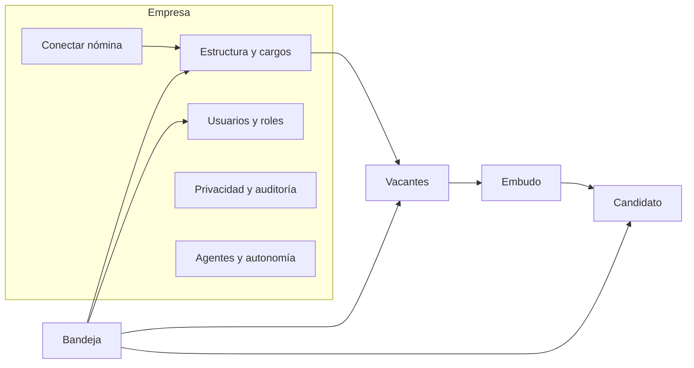

# Validación del diseño contra las historias · Etapa 0

Fecha: 2026-10-21. Fuente de historias: Azure Boards, épicas 149 (Etapa D) y 175 (Etapa 0).
Mock: https://claude.ai/artifact/LZQbmn2f1efZhUML9Wibfn (fuentes en `docs/diseno/mock-app-web/`).

## Hallazgos

1. **Las historias no tenían criterios de aceptación.** Todas traían solo la definición de terminado genérica. Sin criterios, cada pantalla se puede construir como "un formulario más", que es lo que el producto prohíbe. Abajo quedan criterios orientados a diseño para cada historia de la Etapa 0, y se cargaron en Azure.
2. **El mock cubría solo la Etapa 1** (bandeja, vacantes, embudo, candidato, agentes). La Etapa 0 no tenía ninguna pantalla: ni configuración de la empresa, ni roles, ni empresas usuarias, ni privacidad.
3. **La navegación no tenía dónde vivir la empresa.** La barra lateral mostraba la empresa como un texto fijo; una EST que atiende varias empresas usuarias necesita cambiar de contexto en cada pantalla.
4. **El riesgo de la Etapa 0 es que parezca un ERP.** Sedes, áreas, centros de costo y cargos son tablas que en la competencia se digitan a mano. En Selvana la IA los trae del ERP, detecta duplicados y propone; la persona aprueba.

## Matriz historia → diseño

| Historia | Lo que necesita la persona | Pantalla o patrón | Estado antes | Decisión de diseño |
| --- | --- | --- | --- | --- |
| 183 Modelo de datos base | Tener su empresa lista sin digitar | **6 · Conectar nómina** y **7 · Estructura y cargos** | No existía | La estructura llega del ERP; la IA normaliza cargos y propone perfiles; nada se digita desde cero |
| 184 Integración agnóstica + SINCO | Conectar su ERP en minutos y ver qué se importó | **6 · Conectar nómina** | No existía | Cuatro niveles de conexión como tarjetas; vista previa de lo leído antes de aplicar; sincronización con bitácora |
| 185 Roles y permisos | Dar acceso correcto sin entender permisos técnicos | **8 · Usuarios y roles** | No existía | Matriz rol × acción legible; la IA sugiere el rol según el cargo en nómina, con razón y evidencia |
| 186 Multiempresa y empresa usuaria | En una EST, trabajar por cliente sin mezclar datos | Selector de empresa en la barra lateral + **8 · Usuarios y roles** (pestaña Empresas usuarias) | Texto fijo | Selector visible en todas las pantallas; cada usuario ve solo las empresas usuarias asignadas |
| 187 Ley 1581 y bitácora | Demostrar ante la SIC quién autorizó, cuándo y qué hizo cada quien, IA incluida | **9 · Privacidad y auditoría** | No existía | Registro de autorizaciones con evidencia; solicitudes de titulares con plazo legal; bitácora que distingue IA y personas |
| 188 Almacenamiento cifrado | Confiar en que los documentos sensibles están protegidos | **9 · Privacidad y auditoría** (accesos a datos sensibles) + candado en documentos | No existía | No es una pantalla propia: cada acceso a un dato sensible queda en la bitácora y se marca "Dato sensible · acceso por rol" |
| 201 Gateway de IA | Saber cuánto cuesta la IA | **5 · Agentes y autonomía** | Cubierto | Costo del mes y tope por empresa ya diseñados |
| 202 Motor de agentes | Ver qué hizo cada agente, paso por paso | **9 · Privacidad y auditoría** (bitácora, filtro IA) + estados del agente | Parcial | Cada acción del agente es una línea de bitácora con su resultado y quién la aprobó |
| 203 Bandeja genérica | Decidir todo en un solo lugar | **1 · Bandeja de aprobaciones** | Cubierto | Se generaliza: cualquier módulo publica una tarjeta (cargos por unir, rol sugerido, vacante redactada) |
| 204 Banco de pruebas | Confiar en la calidad de cada agente | **5 · Agentes y autonomía** (meta de calidad) | Parcial | La meta y el valor actual se ven por agente; el detalle del banco vive en el pipeline, no en la UI del cliente |
| 205 Evaluación automática | Detectar si un agente empeora | **5 · Agentes y autonomía** | Parcial | Si un agente baja de su meta, su tarjeta pasa a alerta y la autonomía baja a "Sugerir" hasta que alguien la revise |
| 163 Mapa de navegación | Encontrar todo sin manual | Barra lateral nueva (abajo) | Parcial | Grupo "Empresa" con Conectar nómina, Estructura y cargos, Usuarios y roles, Privacidad y auditoría, Agentes |
| 168 / 180 Prototipo navegable | Probar el flujo con 5 profesionales de RRHH | Canvas de Claude Design en modo Play | Parcial | Ahora con 9 pantallas enlazadas: onboarding de empresa + flujo de selección |

## Mapa de navegación de la consola RRHH

Cada rol abre en su bandeja: RRHH en la bandeja de aprobaciones; el líder en sus vacantes y su equipo (Etapa 3); el empleado en el asistente (Etapa 3); el candidato en el portal de empleo o WhatsApp.

## Criterios de aceptación (orientados a diseño)

### 183 · Modelo de datos base
- La empresa queda configurada sin digitar sedes, áreas, centros de costo ni cargos: llegan del ERP o de un archivo.
- La IA detecta cargos duplicados o con nombres distintos para lo mismo y propone unirlos, con razón y evidencia (cantidad de empleados por nombre en el ERP).
- Cada cargo tiene un perfil; si no existe, la IA lo redacta como borrador violeta hasta que RRHH lo apruebe.
- Persona se guarda una sola vez aunque sea candidato y luego empleado (mismo documento).

### 184 · Integración agnóstica y conector SINCO
- La pantalla ofrece los cuatro niveles: conector nativo, API REST, archivo programado por SFTP y carga manual asistida.
- Antes de aplicar una importación se ve el resumen de lo leído (cantidades por entidad, cambios y conflictos) y se aprueba.
- La última sincronización, su resultado y los errores se ven con fecha y hora; un error dice qué registro falló y cómo corregirlo.

### 185 · Roles y permisos
- Seis roles: administrador, gerente RRHH, analista, líder, empleado, candidato; la matriz rol × acción se lee sin conocimientos técnicos.
- Al invitar a una persona, la IA sugiere el rol según su cargo en nómina (p. ej. personas a cargo → líder), con la razón visible.
- Los datos sensibles (salud, pruebas psicológicas) solo los ven los roles autorizados, y la matriz lo muestra.

### 186 · Multiempresa y empresa usuaria
- El selector de empresa está en la barra lateral de todas las pantallas y muestra en qué empresa usuaria se está trabajando.
- Un usuario solo ve las empresas usuarias que tiene asignadas; los datos de una nunca aparecen en otra.
- Cada empresa usuaria puede tener su marca para el portal de empleo (marca blanca).

### 187 · Ley 1581 y bitácora de auditoría
- Cada autorización guarda titular, fecha y hora, canal (portal, WhatsApp, presencial), versión del texto aceptado y evidencia.
- Las solicitudes de titulares (consulta, actualización, supresión) muestran el plazo legal que queda: consultas 10 días hábiles, reclamos 15 días hábiles.
- La bitácora muestra cada acción con quién la hizo (persona o agente de IA), qué cambió y, si fue IA, quién lo aprobó. Se filtra por IA o personas.

### 188 · Almacenamiento documental cifrado
- Los documentos sensibles se marcan "Dato sensible · acceso por rol" donde aparezcan.
- Cada vista o descarga de un documento sensible queda en la bitácora con usuario, fecha y motivo.

### 202 · Motor de agentes
- Cada paso de un agente (herramienta usada, resultado, costo) se ve como línea de bitácora del caso.
- Los estados del agente siguen el patrón: pensando, trabajando con avance real, espera aprobación, listo con quién aprobó, necesita ayuda.

### 203 · Bandeja de aprobaciones genérica
- Cualquier módulo publica tarjetas en la misma bandeja con: qué propone la IA, por qué (3 a 5 razones con evidencia), impacto y botón de decisión.
- Las decisiones que afectan a una persona siempre exigen aprobación humana, sin importar el nivel de autonomía.
- Aprobar o ajustar registra la sugerencia y la decisión.

### 204 y 205 · Banco de pruebas y evaluación
- Cada agente muestra su meta de calidad y el valor actual en "Agentes y autonomía".
- Si un agente queda por debajo de su meta, su tarjeta pasa a alerta y su autonomía baja a "Sugerir" hasta que alguien la revise.
